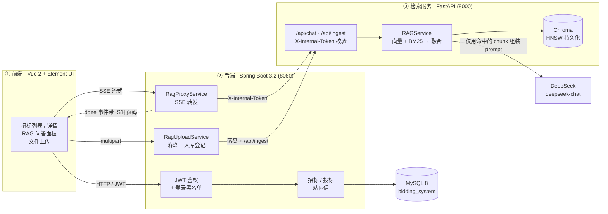

# Bidding RAG · 招投标智能问答

> 招投标 RAG 演示系统：上传招标文件，切块入库，问答带页码溯源。Vue 2 + Spring Boot 3.2 + FastAPI + Chroma 三层，检索层有评测闸门。


---

## 1. 这是什么

招投标场景里的问题，通常不是搜一个词，而是「这份标书里投标保证金要交多少、什么时候截止、什么情况会被判废标」。这些答案散在几百页 PDF 里，通用检索给不出出处。

这个项目把三件事串起来：招标文件按页入库；向量 + BM25 混合检索，用 RRF / RSF 融合；模型只依据命中的 chunk 作答，正文里标 `[S1]`/`[S2]` 指向具体页码。

检索参数改完不能凭"感觉召回变好了"就提交。跑 `eval/gate.ps1`：它跟 `baseline_seed80.json` 比 hit@5 / hit@10，退步超过 3pp 直接退出码 1。

---

## 2. 架构



分三层是三个具体原因。检索服务要能单独重启（换 embedding 模型、修 HNSW 索引）而不影响前端与会话；Java 侧只做鉴权、业务数据与 SSE 透传，不持有检索逻辑；向量库落盘由 Python 独占，避免两个进程同时开同一个 Chroma 库。

---

## 3. 功能特性

| 能力 | 说明 |
|---|---|
| 招标文件问答 | 回答正文带 `[S1]`…`[S6]` 角标，前端可回查「第几页 / 哪一段」 |
| 项目隔离 | 每个 chunk 带 `tender_id`，`retrieve()` 强制传项目号，禁止全库检索；缺失直接抛错而不是静默降级 |
| 拒答 | 命中不足 / 问题与标书无关时明确拒答，不编造条款；题集里有 10 道专测拒答题 |
| 审计 | 每次问答落 `rag_qa_log`：命中数、答案长度、耗时、是否拒答，便于回溯 |
| 上传闭环 | 前端上传 → Java 落盘并在 `tender_document` 登记 → 调 `/api/ingest` 切块入库 → 幂等（同 doc_id 先删后灌） |
| 一键启停 | `scripts/start-all.ps1` 起三端并自动生成 JWT / 内部令牌；`stop-all.ps1` 优雅关停（Python 走 `/api/shutdown` 让 Chroma 收尾） |
| 向量库自愈 | `scripts/repair-vector.ps1` 体检 HNSW 索引，坏库归档到 `_archive/` 并从可重放备份恢复 |
| 评测体系 | 80 题 golden + 判定器 + 基线指纹 + 3pp 回归闸门（`eval/gate.ps1`） |

---

## 4. 技术栈

| 层 | 技术 | 版本 | 用途 |
|---|---|---|---|
| 前端 | Vue 2 / Element UI / axios / Vue Router / Vuex | 2.6 / 2.15 | 页面与问答面板，SSE 流式渲染 |
| 构建 | @vue/cli-service | 4.5 | dev server（8081）+ `/api` 代理到 8080 |
| 后端 | Spring Boot / Spring Security / MyBatis-Plus | 3.2.12 | 鉴权、业务 CRUD、SSE 透传 |
| 鉴权 | JJWT（HS256） | 0.11.x | 无状态 token + 内存黑名单 / 登录失败计数 |
| 数据库 | MySQL | 8.x | 招标、投标、站内信、问答审计 |
| 检索 | FastAPI / uvicorn | 0.110 / 0.29 | 检索 HTTP 服务，仅绑 127.0.0.1 |
| 切片 | PyMuPDF / python-docx / python-pptx / openpyxl | 见 requirements | PDF / Word / PPT / Excel 解析 |
| 向量库 | Chroma（HNSW） | 1.5.9 | 持久化 + 相似度检索 |
| 嵌入 | BAAI/bge-small-zh-v1.5 | via langchain-huggingface | 中文小模型，本地缓存离线加载 |
| 融合 | 向量 + BM25 → RRF / RSF(α=0.3，暂定) | 自实现 | 候选 30 → 融合取 10 → 入 prompt 6 |
| 生成 | DeepSeek（OpenAI 兼容） | deepseek-chat | 只依据命中 chunk 作答 |
| 评测 | 自研 matcher + Wilson95 CI | — | Hit@5 / Hit@10 / ECR + 回归闸门 |

---

## 5. 快速开始

### 5.1 前置

| 依赖 | 版本 | 备注 |
|---|---|---|
| JDK | 17 | 需 `JAVA_HOME` 或按下文覆盖 |
| Maven | 3.9+ | 构建 backend |
| Python | 3.9 | 嵌入模型与 chromadb 1.5.9 的兼容边界（见 §10） |
| Node.js | 16+ | 前端 dev server |
| MySQL | 8.x | 库名 `bidding_system`，字符集 `utf8mb4` |

### 5.2 建库

```bash
mysql -u root -p -e "CREATE DATABASE IF NOT EXISTS bidding_system DEFAULT CHARSET utf8mb4 COLLATE utf8mb4_general_ci;"
mysql -u root -p bidding_system < database/schema.sql
mysql -u root -p bidding_system < database/02_rag_tables.sql
mysql -u root -p bidding_system < database/03_add_confidential.sql
mysql -u root -p bidding_system < database/seed.sql
```

### 5.3 配置

```powershell
copy .env.example rag-service\.env
# 编辑 rag-service\.env，填 DEEPSEEK_API_KEY
```

`JWT_SECRET` 与 `RAG_INTERNAL_TOKEN` 留空即可：`scripts/start-all.ps1` 会各生成一份随机值写到 `_run\jwt-secret.txt` / `_run\rag-token.txt`，并注入两侧环境变量（`_run/` 已在 `.gitignore` 里）。不要手写弱口令，历史默认串是公开的，等于没有鉴权。

### 5.4 装依赖

```powershell
# 后端
cd backend
mvn -q clean package -DskipTests          # 产出 target/bidding-backend-1.0.0.jar

# 前端
cd ..\frontend
npm install

# 检索服务（建议用国内镜像）
cd ..\rag-service
pip install -i https://pypi.tuna.tsinghua.edu.cn/simple -r requirements.txt
```

> **仓库不带测试用的招标文件。** 请自行准备 PDF / DOCX，放入 `rag-service/data/<tender_id>/`，再调用上传接口或 `POST /api/ingest` 入库（见 §7、§5.8）。想跑 `eval/run_eval.py --reingest` 这条重建路径，需要自己把一份招标 PDF 放到 `fixtures/henan_tender.pdf`（`run_eval.py` 的默认路径），或者直接把 `VECTOR_DB_PATH` 指向已有向量库（见 §9）。

### 5.5 一键启动

```powershell
# 从仓库根执行；路径全部由脚本自身位置推导，仓库搬到哪都能跑
.\scripts\start-all.ps1
# 或双击 scripts\start-all.bat
```

脚本分 7 步推进（前置 → Java → 前端 → 向量库检测 → Python → 等就绪 → 入口），就绪后打开：

```
前端    http://localhost:8081
后端    http://localhost:8080
RAG     http://127.0.0.1:8000/api/health
```

演示账号（仅供本地开发，口令固定写在 `database/seed.sql` 里，不要用于任何联网环境）：

| 角色 | 账号 | 密码 |
|---|---|---|
| 管理员 | `admin` | `admin123` |
| 招标单位 | `tender01` | `123456` |
| 厂家 | `mfg01` | `123456` |

常用参数：`-TimeoutSec 300`（三端总上限）、`-SkipRepair`（跳过向量库体检）、`-DbUser/-DbPassword`（默认取 `$env:DB_USER` / `$env:DB_PASSWORD`）。

### 5.6 停止

```powershell
.\scripts\stop-all.ps1
```

> **不要直接 `Stop-Process` 杀 Python。** Chroma 的 HNSW 落盘是非原子的（先 pickle 再写四个 bin），强杀撞进这个窗口会留下半截段文件，库就再也打不开。`stop-all.ps1` 会先 `POST /api/shutdown` 让服务校验向量库并 `close()`，等满 20 s 才兜底强杀。前端无落盘状态，可以直接 `taskkill /T /F`。

### 5.7 换机器要改的三个地方

脚本已按 `$PSScriptRoot` 推导仓库根，不需要改任何路径。只有本机工具链位置需要覆盖（环境变量即可）：

```powershell
$env:RAG_PYTHON = "C:\Path\To\Python39\python.exe"
$env:JAVA_EXE   = "C:\Program Files\Java\jdk-17\bin\java.exe"
$env:DB_USER    = "root"
$env:DB_PASSWORD = "your_mysql_password"
```

### 5.8 检索服务（rag-service）

`rag-service/` 是唯一的检索与生成进程（FastAPI，绑 `127.0.0.1:8000`）。它不对外，只被 Java 调用。

职责是一条流水线：文档解析（PDF / Word / PPT / Excel / TXT）→ 切分（800 / overlap 200，带页码）→ 向量化（bge-small-zh-v1.5）→ 混合检索（向量 + BM25 → RRF / RSF 融合）→ 流式生成（DeepSeek，只依据命中 chunk）。文档管理也在这里：入库幂等（同 `doc_id` 先删后灌）、按 `tender_id` 列表、按 `tender_id` 归属校验删除。

启动：正常路径是由 `scripts/start-all.ps1` 统一拉起（它会生成 `RAG_INTERNAL_TOKEN` 并注入两侧）。单端调试可以手动起：

```powershell
cd rag-service
$env:RAG_INTERNAL_TOKEN = (Get-Content ..\_run\rag-token.txt -Raw).Trim()   # 必须注入
$env:DEEPSEEK_API_KEY   = "sk-..."                                          # 必须注入
uvicorn app.main:app --host 127.0.0.1 --port 8000
```

> `RAG_INTERNAL_TOKEN` 没有默认值：缺失或短于 16 字符时 `Config.assert_internal_token_configured()` 直接抛错，进程 fail-fast 起不来。历史默认串 `rag-internal-dev-token-2026` 视为已泄漏，启动器检测到它会拒绝并重新生成，不要写死。认证调试请从 `_run\rag-token.txt` 读。

关键配置：

| 变量 | 必需 | 说明 |
|---|---|---|
| `DEEPSEEK_API_KEY` | 必需 | 生成层 key（`--mode=llm` 的口语改写也用它） |
| `RAG_INTERNAL_TOKEN` | 必需 | 内部令牌；Java 的 `application.yml` 与本服务 `Config.INTERNAL_TOKEN` 读同一变量，不一致的唯一表现是全链路 401 |
| `RAG_DATA_ROOT` | — | 上传落盘根目录，默认 `rag-service/data`；`/api/ingest` 只接受该目录内的路径，且路径首段必须等于 `tender_id` |

接口（除 `/api/health` 外一律要求 `X-Internal-Token`，缺失/错误 → 401）：

| 方法 | 路径 | 说明 |
|---|---|---|
| GET | `/api/health` | 存活探针，唯一免令牌，不碰数据 |
| POST | `/api/chat` | 流式问答（SSE，只走 `data:` 通道，按 `type` 分流 meta / delta / done / error）；body `{"query": "...", "tender_id": 1, "chat_history": []}`，`query` 与 `tender_id` 缺一即 400 |
| POST | `/api/ingest` | 按落盘路径入库（Java 上传完成后调用）；body 必填 `doc_id` / `tender_id` / `file_path`，路径越出 `RAG_DATA_ROOT`、或首段与 `tender_id` 不符 → 400 |
| GET | `/api/documents?tender_id=` | 文档列表，`tender_id` 必填（全库列表等于把别的项目有什么文件吐出去） |
| DELETE | `/api/documents/{doc_id}?tender_id=` | 删除单个文档，`tender_id` 必填且必须与归属一致；缺参数 400 / 不存在 404 / 归属不符 400（且不透露它属于哪个项目） |
| POST | `/api/documents/upload` | 直传文件（multipart `file`），单端调试用；生产路径走 Java 的 `/api/rag/upload` |
| POST | `/api/shutdown` | 优雅关停（校验向量库 → `close()` → exit），只给 `stop-all.ps1` 调 |

依赖：`rag-service/requirements.txt`（建议清华源，见 §5.4）。解析器为 PyMuPDF / python-docx / python-pptx / openpyxl；除 Chroma 外不依赖额外服务，BM25 是进程内按 `tender_id` 分片的实现。

---

## 6. 目录结构

```
bidding-rag/
├── README.md                    本文档（快速开始 / API / 检索 / 评测 / 取舍）
├── LICENSE                      MIT
├── .gitignore                   依赖、构建产物、密钥、向量库一律不入库
├── .env.example                 环境变量模板（只有占位）
├── docs/
│   └── 设计说明.md               架构、数据模型、检索设计、关键决策、踩坑 8 条
├── backend/                     Spring Boot 3.2（8080）
│   ├── pom.xml
│   └── src/main/
│       ├── java/com/bidding/
│       │   ├── controller/      auth / tender / bid / message / admin / rag
│       │   ├── service/         业务 + RagProxy（SSE） + RagUpload（落盘入库）
│       │   ├── security/        JWT 过滤器、登录失败计数、token 黑名单
│       │   ├── mapper/          MyBatis-Plus 映射
│       │   ├── entity/ dto/ vo/
│       │   ├── common/          统一返回 Result + 全局异常处理
│       │   └── config/          Security / CORS / MyBatis-Plus / 内部令牌
│       └── resources/application.yml
├── frontend/                    Vue 2 + Element UI（8081）
│   ├── package.json  babel.config.js  vue.config.js  .eslintrc.js
│   ├── public/
│   └── src/
│       ├── views/               招标 / 投标 / 站内信 / 后台（admin·tender·manufacturer）
│       ├── components/          RagChatDrawer（SSE 抽屉，只走 data: 通道）
│       └── router/  store/  services/  utils/  assets/
├── rag-service/                 FastAPI 检索服务（8000，只绑回环）
│   ├── requirements.txt
│   ├── .env.example
│   ├── app/
│   │   ├── main.py              /api/health · /api/chat · /api/ingest · /api/documents · /api/shutdown
│   │   ├── core/                config（DATA_ROOT / VECTOR_DB_PATH / 检索深度契约）+ 日志
│   │   ├── api/                 路由层
│   │   ├── parsers/             PDF / DOCX / PPTX / XLSX 解析
│   │   ├── services/            rag_service（检索 + 融合） · qa_service（改写 + 生成）
│   │   └── tools/
│   ├── prompts/qa_prompts.txt   系统提示词（拒答口径、引用格式）
│   └── tests/test_isolation.py  项目隔离回归
├── database/
│   ├── schema.sql               基础表
│   ├── seed.sql                 演示账号与项目（演示数据）
│   ├── 02_rag_tables.sql        rag_qa_log / tender_document
│   └── 03_add_confidential.sql  保密标记列
├── scripts/                     全部用 $PSScriptRoot 推导仓库根
│   ├── start-all.ps1 / .bat     一键启动三端（自动生成两侧密钥）
│   ├── stop-all.ps1  / .bat     优雅停止（Python 走 /api/shutdown）
│   ├── repair-vector.ps1 / .bat 向量库体检 / 自愈
│   └── seed-demo.ps1            演示数据重建（可选，默认 dry-run）
└── eval/                        检索评测与回归闸门
    ├── run_eval.py              主评测：Hit@5 / Hit@10 / ECR + Wilson95
    ├── o2_rewrite_eval.py       口语问法改写评测（base / manual / llm）
    ├── matcher.py               判定器唯一实现（phrase_in + lcs_ratio）+ 自测
    ├── _common.py               tender_id 约定 + Wilson95
    ├── gate.ps1                 三道闸门（matcher 自测 → 跑当前配置 → 对比基线 3pp）
    ├── baseline_probe.py        基线指纹（库 / 题集 / 分数，防止拿错口径比）
    ├── compare.py               两次 run 的逐类对比
    ├── baseline_seed80.json     闸门基线（输入，已随仓库提供）
    ├── _rewrite_strict.json     人工改写映射（--mode=manual 的输入）
    └── golden/
        ├── seed_80.json         70 可答 + 10 拒答
        └── seed_40.json         旧题集（历史对比用）
```

`eval/vector_base`、`_run/`、`vector_data/`、`data/`、`target/`、`node_modules/` 都在 `.gitignore` 里，克隆下来不会跟着走，需按 §9 自行生成。仓库不携带测试用的招标文件：需要样本请自备 PDF / DOCX，按 §5.4 的说明放进 `rag-service/data/<tender_id>/` 后入库。

---

## 7. API

三端端口固定：前端 8081、后端 8080、检索服务 8000（只绑 `127.0.0.1`）。

| 方法                  | 路径                                                      | 鉴权                 | 说明                                                   |
| ------------------- | ------------------------------------------------------- | ------------------ | ---------------------------------------------------- |
| POST                | `/api/auth/login`                                       | 公开                 | 登录，返回 JWT；失败计数 + 锁定                                  |
| POST                | `/api/auth/register`                                    | 公开                 | 注册（厂家 / 招标单位）                                        |
| POST                | `/api/auth/logout`                                      | JWT                | 登出，token 进内存黑名单                                      |
| GET                 | `/api/tenders`                                          | JWT                | 招标项目分页列表                                             |
| GET                 | `/api/tenders/{id}`                                     | JWT                | 项目详情                                                 |
| GET                 | `/api/my-tenders`                                       | JWT                | 我发布的 / 我参与的                                          |
| POST·PUT·DELETE     | `/api/tenders` `/api/tenders/{id}`                      | JWT（招标单位/管理员）      | 项目增改删                                                |
| GET                 | `/api/bids/mine`                                        | JWT（厂家）            | 我的投标                                                 |
| PUT                 | `/api/bids/{id}` · `/{id}/accept` · `/{id}/reject`      | JWT                | 改报价 / 中标 / 淘汰                                        |
| GET·POST·PUT·DELETE | `/api/messages` … `/api/messages/{id}/reply`            | JWT                | 站内信与回复                                               |
| GET                 | `/api/admin/statistics` `/users` `/messages` `/tenders` | JWT（管理员）           | 后台统计与列表                                              |
| PUT                 | `/api/user/info` · `/api/user/password`                 | JWT                | 改资料 / 改密码                                            |
| POST                | `/api/rag/chat`                                         | JWT                | SSE 流式问答；事件 `meta → delta* → done`，`done` 里带引用页码 |
| POST                | `/api/rag/upload`                                       | JWT（招标单位/管理员）      | `multipart/form-data`：`file` + `tender_id`，落盘并触发入库   |
| GET                 | `/api/health`                                           | 公开                 | 检索服务存活探针（唯一免内部令牌的接口）                                 |
| POST                | `/api/chat` `/api/ingest`                               | `X-Internal-Token` | 检索服务内部接口，只给 Java 调，不对外                           |
| POST                | `/api/shutdown`                                         | `X-Internal-Token` | 优雅关停（校验向量库 → close → exit）                           |

鉴权分两层：

1. **浏览器 → 后端**：`Authorization: Bearer <JWT>`，由 Spring Security 过滤器校验，角色走 `@PreAuthorize`。
2. **后端 → 检索服务**：`X-Internal-Token: <随机串>`。8000 只绑回环不等于可信：同机任意进程、SSRF、任何能写 `127.0.0.1:8000` 的东西都能绕过 Java 的全部 JWT 与项目权限。所以除 `GET /api/health` 外一律校验；两侧令牌必须逐字符一致，不一致的唯一表现是全链路 401。

`/api/rag/chat` 请求体：

```json
{ "tender_id": 1, "question": "投标保证金要交多少？" }
```

SSE 响应（节选）：

```
event: meta
data: {"sources":[{"sid":"S1","page":12,"tender_id":1}]}

event: delta
data: {"text":"投标保证金为人民币"}

event: delta
data: {"text":"二十万元 [S1]。"}

event: done
data: {"answer_len":18,"hit_count":6,"latency_ms":1840,"refused":false}
```

---

## 8. 检索是怎么做的

```
query ──┬─→ 向量检索（bge-small-zh-v1.5，candidates=30，tender_id 过滤）
        └─→ BM25 检索（jieba 分词，同一 tender_id 过滤）
                    ↓
              RRF / RSF(α=0.3，暂定) 融合，取 FUSED_K=10
                    ↓
              10 段全部拼进 prompt（带页码；`PROMPT_K=6` 是预留参数，当前未生效）
                    ↓
              DeepSeek 生成 + [S1] 角标；命中不足则拒答
```

几个刻意的设计：

- `retrieve()` 必须传 `tender_id`，传 `None` 直接抛错。关掉项目隔离会让两个项目的条款互相污染，这种错在答案里看不出来，只能靠代码硬性拦住。
- 候选池 30、融合后返回 10、`PROMPT_K=6`，三个数各自可调。`PROMPT_K` 目前未生效，10 段全部进 prompt。
- BM25 与向量同权重区间融合，不做分数归一化 hack。两套分数量纲不能直接加权，这是 RSF 存在的理由。
- 拒答优先：命中数不足或最高分低于阈值时直接拒答并给出理由，不让模型"猜一条最像的"。

---

## 9. 评测

主数字（评测方法与口径见本文 §9）：

| 指标 | 数值 | 95% CI（Wilson） | 说明 |
|---|---|---|---|
| Hit@5 | 72.9%（51/70） | [61.5, 81.9] | 80 题题集，70 可答 + 10 拒答，74 chunk 库 |
| Hit@10 | 82.9%（58/70） | [72.4, 89.9] | 同上 |
| 口语问法（base） | 37.0 / 63.0（10/27、17/27） | [21.5, 55.8]、[44.2, 78.5] | 27 道口语问法，改写层未生效 |
| 口语问法（生产改写） | 81.5 / 92.6（22/27、25/27） | [63.3, 91.8]、[76.6, 97.9] | 走 `qa_service` 的 LLM 改写层 |
| 口语问法（人工改写） | 77.8 / 92.6（21/27） | [59.2, 89.4]、[76.6, 97.9] | 只当上界，人写的 query 不是线上能力 |
| 闸门阈值 | 3pp | — | 70 题里 1 题 = 1.43pp，3pp ≈ 2 题，只放过抽样噪声 |

### 9.1 指标定义

- **Hit@k**：判定式是 `matcher.phrase_in(golden 的 evidence.quote, chunk 正文)`。golden 里标注的原文片段只要是某个被召回 chunk 正文的文本子串，就算这一题命中。所以粒度是文本子串，不是 chunk id 或页码：换 chunk 大小或切分边界不会让判定失真，代价是"命中"只保证答案句被召回，不保证页码/段落结构正确。
- **ECR**：检索质量兜底指标，用 LCS（最长公共子串）字符相似度，不用 bag-of-chars 覆盖率。后者在随机 10 块上也能到 0.96，没有区分度，已废弃。
- **Wilson95**：小样本比例的置信区间（小样本 + 比例接近 0/1 时正态近似会给越界区间），`eval/_common.py` 用纯 `math` 实现，不引 scipy。`run_eval.py` 写 `metrics.hit5_ci` / `hit10_ci`，`o2_rewrite_eval.py` 写 `hit5_ci` / `hit10_ci`。
- **判定器只有一份实现**：`matcher.py`。`phrase_in` 挡住"第十三章"命中"第三章"这类假阳性，`lcs_ratio` 供 ECR 使用；`matcher.py` 自带 30 条正负例自测，非 0 退出即失败。

### 9.2 三种模式（`o2_rewrite_eval.py`）

| 模式 | 送进检索的 query | 含义 |
|---|---|---|
| `--mode=base` | 原始口语 query（"投标要押钱吗"） | 现状基线，也是改写层挂掉时的下限 |
| `--mode=manual` | `_rewrite_strict.json` 里人写好的改写 | 人工上界，衡量天花板，不能当达成值 |
| `--mode=llm` | 生产改写层（DeepSeek）实时改写 | 线上真实路径；改写失败会静默降级回 `base` |

三种模式共用同一套库、同一套 27 道口语题，只有这样三行数字才是同口径的成对比较。

### 9.3 gate 闸门

`eval/gate.ps1` 三道检查，任一不过即退出码 1（0 = 通过）：

1. **判定器自测**：`python matcher.py`（30 条正负例）；
2. **跑当前配置**：`run_eval.py --golden=golden/seed_80.json --out=runs/current.json`；
3. **与基线对比**：先打印 `[baseline_source]`（库 / 题集 / 题数 / 分数 / CI / sha256 前 12 位），再用 `compare.py` 比 `hit@5`、`hit@10`，退步 > 3pp 即 FAIL。

```powershell
cd eval
.\gate.ps1                                                  # 默认基线 baseline_seed80.json
$env:PYTHON_EXE = "C:\Path\To\Python39\python.exe"; .\gate.ps1   # 指定解释器
.\gate.ps1 -Baseline _t07_baseline_broken.json              # 自证闸门会红（期望 exit 1）
```

基线 `baseline_seed80.json` 是输入，随仓库提供（`.gitignore` 里显式放行）。改检索逻辑后必须重跑，不让"感觉更好"的调参进主干。

### 9.4 口径说明

不同向量库、不同题集的数字不能直接比较；27 题的置信区间约 ±15pp，小于该幅度的差异不构成结论。

具体到本仓库：`eval/vector_base`（74 chunk，评测用）与 `rag-service/vector_data`（734 chunk，演示用）是两套库；`seed_80`（70 可答）与 `seed_40`（35 可答）是两套题集。跨库、跨题集相减得到的差值没有意义，所以 `baseline_probe.py` 把库指纹写进闸门输出。

### 9.5 跑起来

```powershell
cd eval

# 首次：向量库不在仓库里（.gitignore 忽略），先建一份（--reingest 需要自备招标 PDF，见 §5.4）
python run_eval.py --golden=golden/seed_80.json --out=./runs/bootstrap.json --reingest
# 也可以复用现成库：$env:VECTOR_DB_PATH = "..\rag-service\vector_data"

# 主评测
python run_eval.py --golden=golden/seed_80.json --out=runs/current.json

# 口语改写（base 现状 / manual 人工上界 / llm 生产改写层）
python o2_rewrite_eval.py --mode=base
python o2_rewrite_eval.py --mode=manual
python o2_rewrite_eval.py --mode=llm

# 回归闸门（改检索后必跑；退出码 0 = 通过）
.\gate.ps1
```

`VECTOR_DB_PATH` 环境变量优先于默认的 `eval/vector_base`，两个评测脚本都认；`--mode=llm` 需要真 `DEEPSEEK_API_KEY`，缺 key 时不会报错，只会安静地降级回 `base`（这一点见 §9.2 表格最后一行）。

---

## 10. 已知限制

| 限制 | 现象 / 影响 | 现状 |
|---|---|---|
| **chromadb HNSW 非原子落盘** | 强杀进程可能留下坏索引，服务启动即 fail-closed（`Error loading hnsw index`） | 用 `scripts/stop-all.ps1` 优雅停；`scripts/repair-vector.ps1` 可体检并从中断点备份恢复，坏库归档到 `_archive/` 不删 |
| **pymupdf 版本被 Python 3.9 锁住** | CVE-2026-3029 / 120752 要求 `pymupdf>=1.26.7`，但 1.26.6+ 的 wheel 要 Python>=3.10；当前只能停在 1.26.5 | 要修此 CVE 必须先把 Python 升到 3.10+，届时 chromadb / embedding 链路需一并回归 |
| **JWT 黑名单与登录失败计数在内存** | 多实例部署时 A 实例登出的 token 在 B 实例仍有效；重启即清零 | 单机演示够用；要上多实例需换成 Redis |
| **前端详情页信息密度高** | 招标详情把资格要求、评分办法、时间节点堆在一屏，窄屏体验一般 | 已做分组折叠，进一步的详情页信息架构还没重做 |
| **评测库与生产库不是同一份** | `eval/vector_base`（74 chunk）与 `rag-service/vector_data`（734 chunk）口径不同，跨库比数字无意义 | `baseline_probe.py` 把库指纹写进闸门输出，混库会当场露馅 |
| **单文档库测不出泄漏** | 只有一个项目时 `leak_count` 恒为 0，跨项目污染只能用两份标书手工验证 | `tests/test_isolation.py` 用双 tender_id 覆盖这条 |

---

## 11. License

[MIT](LICENSE) © 2026 Bidding RAG

---

## 12. 致谢 / 参考

- [Chroma](https://www.trychroma.com/)：本地持久化向量库
- [BAAI/bge-small-zh-v1.5](https://huggingface.co/BAAI/bge-small-zh-v1.5)：中文嵌入模型
- [LangChain](https://python.langchain.com/) / [langchain-huggingface](https://pypi.org/project/langchain-huggingface/)：嵌入与向量库适配
- [FastAPI](https://fastapi.tiangolo.com/) / [Spring Boot](https://spring.io/projects/spring-boot) / [Vue 2](https://v2.vuejs.org/) / [Element UI](https://element.eleme.io/)
- RRF（Reciprocal Rank Fusion, Cormack et al. 2009）与 RSF（Relative Score Fusion）为检索融合的原始出处
- Wilson score interval：小样本比例区间，`eval/_common.py` 纯 `math` 实现，不引 scipy
- 题集 `eval/golden/` 为自建，命中判定依赖人工标注的原文片段；招标文件样本不随仓库分发，请自备（见 §5.4）

---

## 13. Contributing

1. **一次 PR 只做一件事**：检索改动 / 评测改动 / 前端改动分开提，并在描述里写清"改了什么、为什么、怎么验证的"。
2. **提交前跑两件事**：`pytest`（`rag-service/tests/`，至少要过 `test_isolation.py` 的项目隔离回归）和 `eval/gate.ps1`（退出码 0 才算通过；动了检索逻辑就必须附 `[baseline_source]` 输出）。
3. **召回数字要带口径**：PR 里出现的任何召回数字，必须能对上本文 §9 主数字表的某一行（库 + 题集 + 路径 + CI 四元组齐全），否则只写结论不写数字。
4. **不要动的文件**：`.ps1` 保持 UTF-8 with BOM（PS 5.1 会读崩中文注释）；`.env`、`_run/`、`vector_data*` 一律不入库。

---

## 14. Changelog

- **v1.2**：前端工作台拆分（招标 / 投标 / 站内信 / 后台四区）。评测体系落地：`eval/` 判定器（`matcher.py`）、Wilson95、`gate.ps1` 三道闸门、`baseline_seed80.json` 基线。口语问法改写层（base / manual / llm 三模式）上线。
- **v1.1**：安全加固。内部令牌收口（`X-Internal-Token`，无默认值、缺失即 fail-fast）；JWT 登出黑名单 + 登录失败计数；`/api/ingest` 路径与 `tender_id` 绑定；`DELETE` 先验归属后删；日志只留摘要；prompt 注入与引用校验。
- **v1.0**：初版可跑通链路。Vue 2 前端 + Spring Boot 网关 + FastAPI 检索服务 + Chroma 持久化；PDF/DOCX 按页切块入库；混合检索（向量 + BM25 → RRF/RSF）；带 `[S1]` 页码溯源的流式问答；`start-all.ps1` 一键启停。
